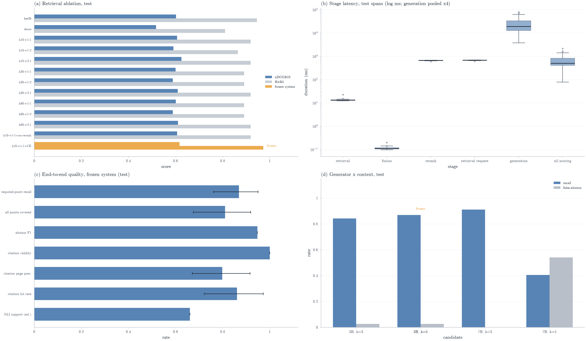

# Production RAG Observability

> Traced RAG with citations

Can a small local model answer questions over the NIST AI Risk
Management Framework with citations that support the claims,
and refuse when the evidence is not there? This project builds it
end to end: pinned PDF ingestion, hybrid retrieval,
cross-encoder reranking, structured JSON generation with code-level
citation validation and abstention, and OpenTelemetry spans
throughout.



The figure follows one frozen benchmark: (a) retrieval ablations over
all 13 systems, (b) per-stage latency from exported spans, (c) end-to-end
quality of the frozen system, (d) generator and context-size ablation.
Panel (b) mixes separate sweeps: generation and NLI spans are traced in
the generator sweep, so the stages do not sum to one request; the traced
lane covers retrieval, fusion and rerank only.

## Results

Frozen system on the 46-question test split (37 answerable, 9
unanswerable): `hybrid-rrf-k10-w1-1` plus cross-encoder rerank@20,
512-token chunks, `qwen2.5-3b-fp16` with 5 evidence chunks, kernel v13.
The 70-question eval set was authored by one person, so treat it as a
smoke benchmark.

| Metric | Value |
| :--- | ---: |
| Required-point recall | 0.869 [0.761, 0.950] |
| All points covered | 0.811 [0.676, 0.919] |
| Abstain precision / recall / F1 | 0.900 / 1.000 / 0.947 |
| False-answer / false-abstain rate | 0.000 / 0.027 |
| Citation label validity | 1.000 |
| Citation page precision / hit rate | 0.799 / 0.861 |
| NLI claim support (estimate) | 0.661 |

- **BM25 beats dense; reranking earns its keep.** bm25 nDCG@10 is 0.602
  vs dense BGE 0.517; the frozen retrieval reaches Hit@5 0.919 and the
  cross-encoder lifts it to 0.973 (MRR@10 0.753 to 0.883).
- **Citations are structurally perfect but semantically weakest.** Label
  validity is 1.000, yet NLI claim support is only an estimated 0.661.
- **Abstention is driven by the model, not the threshold.** The score
  threshold (0.00034) is effectively inactive; abstains come from
  model_abstain (9) and citation validation (1), with false-answer rate
  0.000.
- **Generation is essentially the entire serving cost.** Median about
  19.0 s per `provider.generate` call (P95 about 46.6 s over 280
  calls); rerank adds about 0.66 s, retrieval 13 ms, fusion 0.1 ms.
- **The dev-selected generator was not the test winner.** `qwen2.5-7b-nf4`
  k3 scored recall 0.910 [0.811, 0.991] but with false-answer 0.111; no
  re-selection was done; intervals overlap.

## How it works

```text
NIST PDFs -> sha256 verify -> page-aware token chunks -> BM25 + BGE
dense -> weighted RRF -> cross-encoder rerank -> evidence threshold
-> Qwen JSON (answer, claims, abstain) -> label->chunk resolve ->
citation validation -> response; every stage emits a redacted OTel span
```

Chunking, retrieval, rerank depth and the abstain threshold are
chosen on the 24-question dev split; the frozen config is then
evaluated on test.

## Run it

```bash
uv sync   # core only; --extra neural/otlp add models, OTLP
uv run uvicorn rag_system.api.app:create_app --factory --port 8000
```

```bash
curl -X POST http://localhost:8000/query -H 'Content-Type: application/json' \
  -d '{"query": "What are the core functions of NIST AI RMF?"}'
```

```bash
uv run pytest
uv run ruff check .
uv run mypy src
./scripts/kaggle_run.sh   # full kernel: ingest, tune on dev, freeze, test
```
